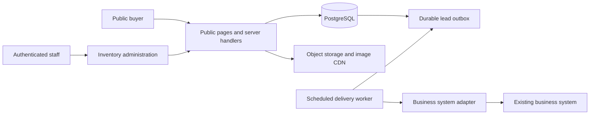

# Truxman Motors — MVP Architecture

## Scope and assumptions

Implement the public showroom and its essential administration and lead connection. The workspace has no existing application stack; the following is a proposed implementation baseline, not installed software. The larger proposal's CRM, financing, invoicing, costing and owner reporting are excluded.

An existing business system is expected to receive website leads. Its API and inventory ownership are not supplied. Resolve this boundary before implementation. If it does not exist yet, store enquiries durably in the MVP database and provide a minimal staff inbox/export while preserving the future adapter interface. Do not silently expand into a CRM.

## Proposed baseline

Use a TypeScript Next.js application with server-rendered public pages and server-side handlers, PostgreSQL for structured data, managed authentication for staff, and S3-compatible object storage/CDN for photos. Use utility CSS with the tokens in `DESIGN.md`. Pin supported versions and confirm provider capabilities when implementation begins.

Keep one application and one database for this small inventory workload. Provider selection remains open until budget, region, credentials and existing infrastructure are known. Avoid microservices, a dedicated search cluster and a separate CMS for this MVP. Indexed database queries are sufficient for the initial roughly 20 vehicles described in the brief.

## Ownership and boundaries

Public clients receive only published inventory fields. Prices, state changes, lead creation and photo operations are validated on the server. Private customer data never enters public page payloads.

Choose exactly one inventory source of truth:

- **Standalone MVP default:** the MVP database owns vehicles and staff edits them here.
- **Existing operational inventory:** the business system owns vehicles; the site reads a synchronized projection and admin mutations go through its API. Do not maintain competing editable copies.

The default applies until an existing inventory API is confirmed. Define stable external IDs, cache invalidation and synchronization failures if using the second option. A staff update should immediately invalidate affected listings; aim for public propagation within 60 seconds and expose failures to staff.

## Logical data model

| Entity | Essential fields |
| --- | --- |
| Vehicle | UUID, optional external ID, unique stable slug, make, model, year, price amount, currency `KES`, mileage km, fuel type, transmission, location ID, description, publication state, availability, published/sold timestamps, created/updated timestamps, version |
| VehicleImage | UUID, vehicle ID, storage key, alt text, display order, width, height; cover image determined by first position |
| Location | UUID, name, confirmed address, optional coordinates, phone and hours |
| Lead | UUID, optional vehicle ID, type `enquiry`/`viewing`, name, normalized phone, optional email, message, preferred viewing time, source `website`, allowed attribution fields, idempotency key, upstream ID, created timestamp |
| LeadDelivery | Lead ID, state `pending`/`delivered`/`failed`, attempt count, next attempt, last safe error, delivered timestamp |
| StaffProfile | Auth provider ID, role, active flag; passwords belong to the identity provider |
| AuditEvent | Actor ID, action, entity ID, safe changed fields, timestamp |

Publication states: `draft`, `published`, `archived`. Availability: `available`, `reserved`, `sold`. Drafts never appear publicly. Reserved cars display their state; permit enquiries but explain that a viewing requires availability confirmation. Sold cars cannot accept new vehicle-specific viewing requests. Keep useful sold pages accessible with alternatives; exclude them from available inventory queries.

Use database constraints for nonnegative prices/mileage, valid enums, unique slugs and idempotency keys, foreign keys and image ordering. Represent money using integer minor units or exact decimals, never floating point. Store timestamps in UTC and display scheduling in `Africa/Nairobi`. Prevent lost edits with an optimistic version check. Do not delete vehicles with linked leads; archive them.

## Public reads and search

Server-render `/`, `/vehicles` and vehicle details for reliable first paint and crawlable content. Fetch only published fields. Search/filter query parameters are allowlisted, typed and bounded. Paginate results; use deterministic sort order with an ID tie-breaker. Index publication/availability, make/model, price, year and location as actual query plans require.

Cache public reads with explicit invalidation on publish, specification changes, photo changes and availability changes. Check live vehicle state again when accepting a viewing request; a stale page must not create a request for a now-sold vehicle. Return a clear availability error with alternatives.

## Lead capture and integration

1. Buyer submits a server-validated form with an idempotency key and optional attribution.
2. Check rate limits, abuse indicators and current vehicle state. Validate date/time in Nairobi time; a request is not a confirmed booking.
3. In one database transaction, insert the lead and pending delivery record. Return success only after commit.
4. A scheduled worker claims pending records with a lease/lock, sends a versioned payload through the adapter, and records the upstream ID and acknowledgement.
5. Retry transient errors with bounded exponential backoff. Retain failed records for staff recovery and alert on persistent failures. Leases expire to recover crashed workers.

Use the local lead UUID as the upstream idempotency key. Delivery is at least once; the receiver must deduplicate for effectively one lead per submission. If it cannot, reconcile before replaying ambiguous timed-out requests. Never drop a lead because the CRM or an optional notification provider is offline.

Adapter payload: schema version, lead ID, submission time, enquiry type, vehicle ID/external ID, buyer contact, message, preferred viewing time and source/allowed campaign metadata. Use server-held credentials over HTTPS; verify the receiver's authentication contract. Optional email notifications follow persistence and never determine submission success. WhatsApp links do not automatically ingest conversations.

## Staff access and photos

Protect every administration read and mutation on the server, not just in navigation. Use invite-only staff access and role checks; staff maintain inventory and review delivery failures, administrators manage access. No public account signup is needed.

Validate image type from decoded content, size and dimensions. Reject executable uploads and unsafe SVGs. Store originals privately where appropriate; serve normalized image derivatives under generated object keys. Strip location metadata, support ordering/cover selection, and clean unused uploads after a grace period. Restrict upload permissions to staff and never accept a client-supplied storage path as authority.

## Security and operational controls

Use TLS, managed secret storage, parameterized database access, restrictive permissions, safe error messages, input length limits, output escaping and same-origin/CSRF protections for cookie-authenticated mutations. Rate-limit public submission without making a visual CAPTCHA the default. Add a honeypot and introduce accessible challenge handling only when abuse warrants it.

Do not log enquiry messages, full phone numbers, credentials or tokens. Exclude admin/private routes from indexing and enforce authorization regardless of robots rules. Agree a documented retention period and deletion/export procedure with the business before launch; obtain current local privacy guidance when implementing the policy.

Record failed deliveries, form failures, deployment errors and image-processing failures in redacted monitoring. Back up the database daily with an agreed retention window; test a restore before handover. Confirm object storage recovery/versioning and record the expected recovery time and data-loss window with the chosen provider.

## SEO and business presence

Create unique metadata and canonical URLs for published vehicle pages. Include current public pages in the sitemap; avoid arbitrary filter URLs and private routes. Use permanent redirects if a slug changes. Display sold status truthfully in metadata and structured data; never leave an available offer for sold stock.

Add business and vehicle/product structured data only for visible, verified facts. Confirm applicable search documentation during implementation; no schema guarantees enhanced search presentation. Prepare consistent name/address/phone/hours, directions, authentic photos and site links for Google Business Profile. Owner verification remains an external dependency.

## Deployment and ownership

Maintain local, preview/staging and production environments, with separate secrets and data. Preview environments use test leads and cannot deliver to the production business system. CI checks types, linting, production build and meaningful critical-flow tests. Review database migrations; take a backup before destructive schema changes and provide application rollback steps.

Set up the agreed domain in a client-owned registrar account, DNS, production hosting, database, storage and TLS. Redirect to one canonical hostname, monitor certificate renewal and document account ownership. Record first-period coverage, limits, renewal date and recurring charges; setup does not imply perpetual free hosting. Deliver administrator access, deployment instructions, backup/restore instructions and staff training through a secure handover process.

## Validation and delivery gates

| Gate | Evidence |
| --- | --- |
| Inventory | Staff creates a draft, uploads/orders images, publishes, edits price, marks sold; public state updates correctly |
| Lead reliability | Accepted enquiry survives upstream outage; worker retries; duplicate submission and retry create one logical lead |
| Viewing | Past date rejected; sold-car race rejected; preferred slot remains a request until staff confirms |
| Authorization | Anonymous users cannot read leads, mutate inventory or upload images; inactive staff denied |
| Mobile/accessibility | 320px viewport, keyboard navigation, focus, form errors and image gallery verified |
| Performance/search | Mobile lab audit, image budgets, crawlable detail content, metadata, sitemap and robots checked |
| Operations | Staging-to-production deployment, domain/TLS, restore exercise, redacted alerts and handover completed |

Implement in four reviewable stages: brand and interface approval; public inventory with administration; durable forms with the adapter; search foundation, QA, deployment and handover. The proposal's four-week website phase is context rather than a guaranteed schedule until content and integration dependencies are confirmed.

## Decisions still needed

Confirm the upstream system/API contract and inventory owner, domain choice, hosting budget and first-period dates, verified business details, staff accounts, photo supply, lead retention policy and who responds to enquiries. These are bounded implementation dependencies; they do not authorize building the rest of the business platform.
