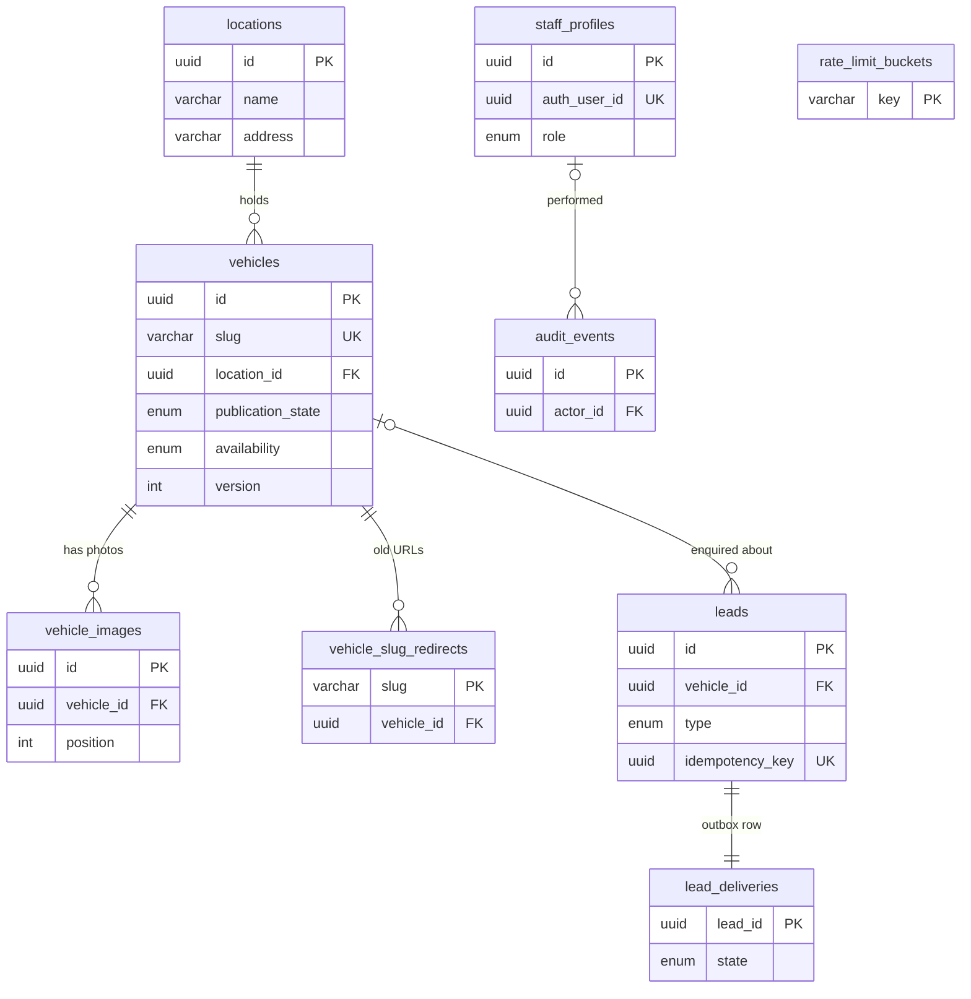

# Truxman Motors — MVP Data Model

This document describes every table the MVP showroom needs, what each one is for, and every field it holds. It expands the "Logical data model" section of [`ARCHITECTURE.md`](../ARCHITECTURE.md) and matches the implemented schema.

| Source of truth | Purpose |
| --- | --- |
| [`prisma/schema.prisma`](../prisma/schema.prisma) | Tables, columns, types, relations, indexes |
| [`prisma/migrations/*/migration.sql`](../prisma/migrations) | CHECK constraints and row-level security that Prisma cannot express |

When the schema changes, update all three files together.

## Conventions

- **Database:** PostgreSQL (Supabase). Table and column names are `snake_case`; Prisma models use `camelCase`.
- **Primary keys:** UUIDs generated by the application, except where a natural key is better (`vehicle_slug_redirects.slug`, `lead_deliveries.lead_id`, `rate_limit_buckets.key`).
- **Timestamps:** `TIMESTAMPTZ(3)`, always stored in UTC. The UI converts to `Africa/Nairobi` for display and for validating viewing times.
- **Money:** integer minor units (`BIGINT`, KES cents). Never use floating point. Example: KES 1,250,000 is stored as `125000000`.
- **Enums:** native PostgreSQL enums, so invalid states are rejected by the database.
- **Access:** all reads and writes go through the Next.js server. Row-level security is enabled on every table with **no policies**, so Supabase's public `anon`/`authenticated` API keys can read or write nothing.
- **Personal data:** customer contact details live only in `leads`. They never appear in public payloads, logs, or `audit_events`.

## Entity relationship diagram

`rate_limit_buckets` has no relationships; it is an operational table.

## Table summary

| # | Table | Area | Purpose |
| --- | --- | --- | --- |
| 1 | `locations` | Inventory | Showroom/yard addresses, phone and hours |
| 2 | `vehicles` | Inventory | One row per car listing |
| 3 | `vehicle_images` | Inventory | Ordered photos for each vehicle |
| 4 | `vehicle_slug_redirects` | SEO | Old vehicle URLs that permanently redirect |
| 5 | `leads` | Leads | Enquiries and viewing requests from buyers |
| 6 | `lead_deliveries` | Leads | Durable outbox for sending leads to the business system |
| 7 | `staff_profiles` | Admin | Staff authorization (role, active flag) |
| 8 | `audit_events` | Admin | History of staff changes |
| 9 | `rate_limit_buckets` | Security | Abuse protection counters for public endpoints |

## Enums

| Enum | Values | Used by |
| --- | --- | --- |
| `publication_state` | `draft`, `published`, `archived` | `vehicles.publication_state` |
| `availability` | `available`, `reserved`, `sold` | `vehicles.availability` |
| `fuel_type` | `petrol`, `diesel`, `hybrid`, `plug_in_hybrid`, `electric`, `other` | `vehicles.fuel_type` |
| `transmission` | `automatic`, `manual` | `vehicles.transmission` |
| `lead_type` | `enquiry`, `viewing` | `leads.type` |
| `lead_source` | `website` | `leads.source` |
| `delivery_state` | `pending`, `delivered`, `failed` | `lead_deliveries.state` |
| `staff_role` | `staff`, `admin` | `staff_profiles.role` |

Publication state and availability are independent. Publication controls **whether the public can see** a listing; availability says **whether the car can still be bought**.

| | `available` | `reserved` | `sold` |
| --- | --- | --- | --- |
| `draft` | Hidden | Hidden | Hidden |
| `published` | Listed, enquiries and viewings allowed | Listed with "Reserved" notice; enquiries allowed, viewing needs confirmation | Detail page stays live with "Sold" notice; excluded from inventory results; enquiries only, no viewings |
| `archived` | Hidden | Hidden | Hidden |

---

## 1. `locations`

Physical showroom or yard where vehicles are kept. Shown on vehicle detail pages and the contact page.

| Column | Type | Null | Default | Description |
| --- | --- | --- | --- | --- |
| `id` | `UUID` | No | generated | Primary key |
| `name` | `VARCHAR(120)` | No | | Display name, e.g. "Ridgeways Showroom" |
| `address` | `VARCHAR(300)` | No | | Confirmed street address |
| `latitude` | `DECIMAL(9,6)` | Yes | | Optional map coordinate |
| `longitude` | `DECIMAL(9,6)` | Yes | | Optional map coordinate |
| `phone` | `VARCHAR(32)` | Yes | | Verified contact number for this location |
| `hours` | `VARCHAR(300)` | Yes | | Opening hours as display text |
| `created_at` | `TIMESTAMPTZ(3)` | No | `now()` | Row creation time |
| `updated_at` | `TIMESTAMPTZ(3)` | No | auto | Last modification time |

**Rules**

- A location that still has vehicles cannot be deleted (`ON DELETE RESTRICT`); move or archive the vehicles first.
- Public: all fields except timestamps appear on vehicle detail and contact pages. Only `id` and `name` appear on inventory cards.

## 2. `vehicles`

One row per car listing. This is the inventory source of truth in the standalone MVP (see "Ownership and boundaries" in `ARCHITECTURE.md`).

| Column | Type | Null | Default | Description |
| --- | --- | --- | --- | --- |
| `id` | `UUID` | No | generated | Primary key |
| `external_id` | `VARCHAR(100)` | Yes | | ID in the upstream business system, if inventory is ever synchronized. Unique |
| `slug` | `VARCHAR(120)` | No | | URL segment for `/vehicles/[slug]`, e.g. `2018-toyota-harrier-a1b2`. Unique, lowercase kebab-case |
| `make` | `VARCHAR(60)` | No | | Manufacturer, e.g. "Toyota" |
| `model` | `VARCHAR(80)` | No | | Model name, e.g. "Harrier" |
| `year` | `SMALLINT` | Yes* | | Manufacture year, 1950–2100 (app limits to next year) |
| `price_amount` | `BIGINT` | Yes* | | Price in KES cents; ≥ 0 |
| `currency` | `CHAR(3)` | No | `'KES'` | Always `KES` |
| `mileage_km` | `INTEGER` | Yes* | | Odometer reading in km; ≥ 0 |
| `fuel_type` | `fuel_type` | Yes* | | Fuel type enum |
| `transmission` | `transmission` | Yes* | | Transmission enum |
| `location_id` | `UUID` | Yes* | | FK → `locations.id`. Where the car can be viewed |
| `description` | `VARCHAR(5000)` | Yes* | | Short factual description |
| `publication_state` | `publication_state` | No | `draft` | Public visibility |
| `availability` | `availability` | No | `available` | Sale status |
| `published_at` | `TIMESTAMPTZ(3)` | Yes* | | First publication time; used for "newest" sort. Kept when unpublished |
| `sold_at` | `TIMESTAMPTZ(3)` | Yes | | Set when marked sold; cleared on a sold correction |
| `created_at` | `TIMESTAMPTZ(3)` | No | `now()` | Row creation time |
| `updated_at` | `TIMESTAMPTZ(3)` | No | auto | Last modification time |
| `version` | `INTEGER` | No | `1` | Optimistic lock. Every update must send the current value and increments it |

\* Nullable so staff can save incomplete drafts, but **required when published** (see constraints).

**Constraints**

- `slug` matches `^[a-z0-9]+(-[a-z0-9]+)*$` and is unique.
- `price_amount >= 0`, `mileage_km >= 0`, `year BETWEEN 1950 AND 2100`, `currency = 'KES'`, `version >= 1`.
- `sold_at` is set **if and only if** `availability = 'sold'`.
- When `publication_state = 'published'`, these must all be non-null: `year`, `price_amount`, `mileage_km`, `fuel_type`, `transmission`, `location_id`, `description`, `published_at`. The application additionally requires at least one image.

**Indexes**

| Index | Supports |
| --- | --- |
| `(publication_state, availability, published_at DESC, id)` | Public inventory listing and "newest" sort |
| `(make, model)` | Make/model search |
| `(price_amount, id)` | Price filter and price sorts with deterministic tie-break |
| `(year)` | Year filter |
| `(location_id)` | Location filter |
| unique `slug`, unique `external_id` | Detail page lookup, sync matching |

**Rules**

- New listings are always created as `draft`.
- Marking sold requires explicit confirmation. Changing a sold car back to available/reserved requires a reason and is audited as a correction.
- A vehicle with linked leads cannot be deleted; archive it instead. A published vehicle must be unpublished before deletion.
- Every publish, price, specification, photo or availability change invalidates the public cache for that vehicle.
- Public fields: `id`, `slug`, `make`, `model`, `year`, price (converted to whole KES), `currency`, `mileage_km`, `fuel_type`, `transmission`, `availability`, `published_at`, `sold_at`, `updated_at`, `description` (detail page only), and the location. `external_id`, `publication_state`, `version` and `created_at` stay private.

## 3. `vehicle_images`

Ordered photos for a vehicle. The file itself lives in object storage; this table holds its metadata.

| Column | Type | Null | Default | Description |
| --- | --- | --- | --- | --- |
| `id` | `UUID` | No | generated | Primary key |
| `vehicle_id` | `UUID` | No | | FK → `vehicles.id` |
| `storage_key` | `VARCHAR(300)` | No | | Server-generated object key, format `vehicles/{vehicleId}/{uuid}.webp`. Unique |
| `alt_text` | `VARCHAR(200)` | No | | Accessible description of the photo |
| `position` | `INTEGER` | No | | Display order starting at 0. **Position 0 is the cover image** |
| `width` | `INTEGER` | No | | Stored image width in px (> 0) |
| `height` | `INTEGER` | No | | Stored image height in px (> 0) |
| `bytes` | `INTEGER` | No | | Stored file size (> 0) |
| `created_at` | `TIMESTAMPTZ(3)` | No | `now()` | Upload time |

**Constraints:** unique `(vehicle_id, position)`; `position >= 0`; `width`, `height`, `bytes > 0`. Deleting a vehicle cascades to its image rows, and the application removes the stored objects.

**Rules**

- Uploads are at most 15 MB, decoded and re-encoded server-side as WebP (max 2000px edge), with metadata (including GPS) stripped.
- Maximum 30 photos per vehicle.
- The client never supplies `storage_key`; the server generates it.
- Reordering rewrites `position` for all images of the vehicle; the first one becomes the cover.

## 4. `vehicle_slug_redirects`

Keeps old vehicle URLs working after a slug change, so search engines and shared links get a permanent (308) redirect.

| Column | Type | Null | Default | Description |
| --- | --- | --- | --- | --- |
| `slug` | `VARCHAR(120)` | No | | Primary key. The old slug |
| `vehicle_id` | `UUID` | No | | FK → `vehicles.id`. The vehicle it now points to |
| `created_at` | `TIMESTAMPTZ(3)` | No | `now()` | When the redirect was created |

**Rules**

- A redirect is only recorded when the vehicle has been published before (drafts have no public URL to preserve).
- If a vehicle takes back a slug that is in this table, the redirect row is removed.
- Cascades on vehicle deletion.

## 5. `leads`

Every enquiry or viewing request submitted from the website. Saved before success is shown to the buyer, so no lead is lost even if the business system is offline.

| Column | Type | Null | Default | Description |
| --- | --- | --- | --- | --- |
| `id` | `UUID` | No | generated | Primary key. Also sent upstream as the idempotency key |
| `vehicle_id` | `UUID` | Yes | | FK → `vehicles.id`. Null for general enquiries from `/contact` |
| `type` | `lead_type` | No | | `enquiry` or `viewing` |
| `name` | `VARCHAR(120)` | No | | Buyer's name |
| `phone` | `VARCHAR(20)` | No | | Normalized E.164 phone, e.g. `+254712345678` |
| `email` | `VARCHAR(254)` | Yes | | Optional email |
| `message` | `VARCHAR(2000)` | Yes | | Buyer's message |
| `preferred_viewing_at` | `TIMESTAMPTZ(3)` | Yes | | Requested viewing slot (UTC). A request, not a confirmed booking |
| `source` | `lead_source` | No | `website` | Origin channel |
| `utm_source` | `VARCHAR(100)` | Yes | | Allowed campaign attribution |
| `utm_medium` | `VARCHAR(100)` | Yes | | Allowed campaign attribution |
| `utm_campaign` | `VARCHAR(100)` | Yes | | Allowed campaign attribution |
| `utm_content` | `VARCHAR(100)` | Yes | | Allowed campaign attribution |
| `utm_term` | `VARCHAR(100)` | Yes | | Allowed campaign attribution |
| `idempotency_key` | `UUID` | No | | Generated by the form; makes double-taps and retries create one lead. Unique |
| `upstream_id` | `VARCHAR(200)` | Yes | | ID returned by the business system after delivery |
| `confirmation_sent_at` | `TIMESTAMPTZ(3)` | Yes | | When the "we received your request" email was accepted by the email provider |
| `confirmation_attempts` | `INTEGER` | No | `0` | Confirmation email attempts so far (≥ 0, max 5) |
| `confirmation_error` | `VARCHAR(500)` | Yes | | Last confirmation email failure, with no customer data |
| `created_at` | `TIMESTAMPTZ(3)` | No | `now()` | Submission time |

**Constraints**

- `phone` matches `^\+[1-9][0-9]{6,14}$`.
- `type = 'viewing'` requires `preferred_viewing_at`.
- `confirmation_sent_at` can only be set when `email` is present; `confirmation_attempts >= 0`.
- A vehicle with leads cannot be deleted (`ON DELETE RESTRICT`).

**Indexes:** unique `idempotency_key`; `created_at DESC` (staff inbox); `vehicle_id`.

**Rules**

- The lead and its `lead_deliveries` row are inserted in **one transaction**.
- On submission the vehicle row is locked and re-checked: it must be published, and a viewing cannot be requested for a sold car.
- Viewing times must be in the future and within 90 days, validated in Nairobi time.
- Viewing requests require an email (application rule, so older rows may lack one). Whenever an email is given, a confirmation email is sent after the lead is committed. It never affects whether the submission succeeds. The cron job retries failures up to 5 times within 23 hours, using `lead-confirmation-{id}` as the provider idempotency key so a retry never sends a second copy.
- Never public. Never logged in full. Retention period still needs to be agreed with the business.

## 6. `lead_deliveries`

Durable outbox: one row per lead, tracking delivery to the existing business system. A scheduled worker claims due rows with a lease.

| Column | Type | Null | Default | Description |
| --- | --- | --- | --- | --- |
| `lead_id` | `UUID` | No | | Primary key and FK → `leads.id` (one-to-one) |
| `state` | `delivery_state` | No | `pending` | `pending`, `delivered` or `failed` |
| `attempts` | `INTEGER` | No | `0` | Delivery attempts so far (≥ 0) |
| `next_attempt_at` | `TIMESTAMPTZ(3)` | No | `now()` | Earliest time the worker may try again |
| `lease_until` | `TIMESTAMPTZ(3)` | Yes | | Set while a worker holds the row; an expired lease means the worker crashed and the row can be reclaimed |
| `last_error` | `VARCHAR(500)` | Yes | | Last failure summary, with no customer data |
| `delivered_at` | `TIMESTAMPTZ(3)` | Yes | | Successful delivery time |
| `updated_at` | `TIMESTAMPTZ(3)` | No | auto | Last modification time |

**Constraints:** `attempts >= 0`; `delivered_at` is set **if and only if** `state = 'delivered'`. Cascades on lead deletion.

**Index:** `(state, next_attempt_at)` so the worker can find due rows quickly.

**Rules**

- Worker lease is 120 seconds. Rows are claimed with `FOR UPDATE SKIP LOCKED` so concurrent workers are safe.
- Retries use exponential backoff with jitter (about 30s, 1m, 2m… capped at 6h), up to 8 attempts. Permanent errors or exhausted retries move the row to `failed`.
- Staff can requeue a failed delivery, which resets it to `pending` with `attempts = 0`.

## 7. `staff_profiles`

Authorization for staff who use `/admin`. Passwords and sign-in are handled by Supabase Auth; this table only says who is allowed in and with which role.

| Column | Type | Null | Default | Description |
| --- | --- | --- | --- | --- |
| `id` | `UUID` | No | generated | Primary key |
| `auth_user_id` | `UUID` | No | | The Supabase Auth user ID. Unique |
| `email` | `VARCHAR(254)` | No | | Staff email (for display and invitations) |
| `role` | `staff_role` | No | `staff` | `staff` maintains inventory and reviews leads; `admin` also manages staff access |
| `active` | `BOOLEAN` | No | `true` | Inactive staff are denied on every request, even with a valid session |
| `created_at` | `TIMESTAMPTZ(3)` | No | `now()` | Row creation time |
| `updated_at` | `TIMESTAMPTZ(3)` | No | auto | Last modification time |

**Rules:** invite-only, no public signup. Deactivate rather than delete so audit history keeps its actor.

## 8. `audit_events`

Append-only history of staff actions, for accountability and for correcting mistakes such as a wrongly marked sale.

| Column | Type | Null | Default | Description |
| --- | --- | --- | --- | --- |
| `id` | `UUID` | No | generated | Primary key |
| `actor_id` | `UUID` | Yes | | FK → `staff_profiles.id`. Set to null if the profile is ever deleted |
| `action` | `VARCHAR(80)` | No | | What happened (see list below) |
| `entity_type` | `VARCHAR(40)` | No | | `vehicle`, `vehicle_image`, `location`, `lead` or `staff` |
| `entity_id` | `VARCHAR(100)` | No | | ID of the affected row (or `export` for lead exports) |
| `changes` | `JSONB` | Yes | | Safe summary of what changed: field names, before/after for state and price, correction reason. **Never** customer contact details or secrets |
| `created_at` | `TIMESTAMPTZ(3)` | No | `now()` | When it happened |

**Index:** `(entity_type, entity_id, created_at DESC)` for "history of this vehicle" views.

**Actions recorded**

| Area | Actions |
| --- | --- |
| Vehicles | `vehicle.created`, `vehicle.updated`, `vehicle.published`, `vehicle.unpublished`, `vehicle.archived`, `vehicle.marked_sold`, `vehicle.sold_corrected`, `vehicle.availability_changed`, `vehicle.deleted` |
| Photos | `vehicle_image.added`, `vehicle_image.reordered`, `vehicle_image.updated`, `vehicle_image.deleted` |
| Locations | `location.created`, `location.updated`, `location.deleted` |
| Leads | `lead.exported`, `lead.delivery_requeued` |
| Staff | `staff.invited`, `staff.updated` |

Audit rows are written in the same transaction as the change they describe.

## 9. `rate_limit_buckets`

Fixed-window counters that rate-limit public endpoints across serverless instances without extra infrastructure.

| Column | Type | Null | Default | Description |
| --- | --- | --- | --- | --- |
| `key` | `VARCHAR(120)` | No | | Primary key: `{scope}:{hashed identifier}`. The IP is HMAC-hashed, never stored raw |
| `window_start` | `TIMESTAMPTZ(3)` | No | | Start of the current window |
| `count` | `INTEGER` | No | | Requests in the current window (≥ 1) |

**Current limits**

| Scope | Limit |
| --- | --- |
| `lead` | 8 submissions per IP per 15 minutes |
| `sign-in` | 5 sign-in link requests per IP per 15 minutes |
| `password-sign-in` | 10 password attempts per IP per 15 minutes |

Rows older than 24 hours can be purged.

---

## Delete behaviour summary

| Parent → child | On parent delete |
| --- | --- |
| `locations` → `vehicles` | Blocked |
| `vehicles` → `vehicle_images` | Cascade (stored files removed by the app) |
| `vehicles` → `vehicle_slug_redirects` | Cascade |
| `vehicles` → `leads` | Blocked (archive the vehicle instead) |
| `leads` → `lead_deliveries` | Cascade |
| `staff_profiles` → `audit_events` | `actor_id` set to null |

## Data stored outside the database

| Data | Where |
| --- | --- |
| Staff passwords, sessions, invitations | Supabase Auth |
| Vehicle photo files | Supabase Storage (S3-compatible) bucket, served via CDN |
| Sent confirmation emails | Resend (email provider) |
| Business name, brand copy, About page text | Application code/content (no CMS in the MVP) |
| Secrets (API keys, adapter credentials, hash secret) | Managed environment variables |

## Deliberately not modelled

These belong to the wider business platform in the original proposal and are **out of scope** for the MVP. Do not add tables for them without a scope decision:

- Customer accounts, saved searches, favourites
- CRM pipeline (lead status, assignee, follow-up notes) — the staff inbox is a fallback view of `leads`, not a CRM
- Confirmed bookings or a viewing calendar — `preferred_viewing_at` is only a request
- Financing, invoices, payments, brokers, costing, owner reporting
- WhatsApp conversation ingestion, analytics events, reviews or testimonials
- Vehicle features/specification lists beyond the fields above (add only if the business supplies verified data)

## Open decisions affecting the model

- **Inventory owner:** if the business system turns out to own inventory, `vehicles` becomes a synchronized read projection keyed by `external_id`, and admin edits go through its API.
- **Lead retention:** agree a retention period and deletion/export procedure for `leads` before launch.
- **Upstream contract:** confirm the business system deduplicates on lead ID, which `lead_deliveries` relies on for at-least-once delivery.
